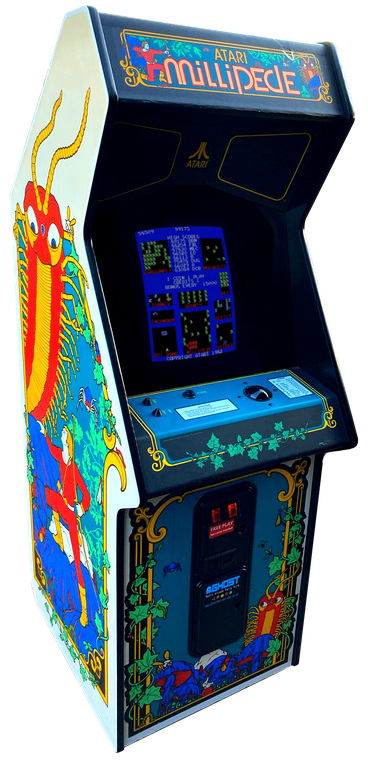
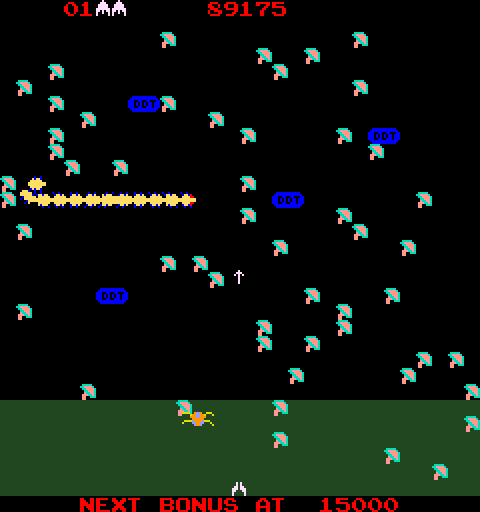

# Millipede (Arcade, 1982) for MiSTer FPGA

An FPGA implementation of Atari's **Millipede** arcade game for the [MiSTer FPGA](https://github.com/MiSTer-devel/Main_MiSTer/wiki) platform, built from Atari's schematic package SP-217.

The sequel to Centipede: a Trak-Ball, a garden of mushrooms and a millipede winding down the screen, with bees, earwigs, dragonflies, inchworms, beetles and spiders joining in. DDT bombs take out everything nearby.

<p align="center">
  
  
</p>

> **Early build.** Tested on MiSTer over HDMI with an arcade trackball; the analog (CRT) output has not been tried yet. Feedback and bug reports are welcome via [Issues](https://github.com/Usquebagh/Arcade-Millipede_MiSTer/issues).

---

## Original Hardware

| Subsystem | Original Hardware | FPGA Implementation |
|---|---|---|
| **CPU** | MOS 6502 @ 1.512 MHz (cycle stretched on playfield RAM accesses) | Arlet Ottens' verilog-6502 |
| **Video** | 32 × 30 character playfield, 16 motion objects per line through a line buffer, 32-entry colour RAM | `millipede.v`, from the SP-217 schematics |
| **Sound** | 2 × Atari POKEY @ 1.512 MHz into a current-to-voltage output stage | Mark Watson's POKEY + a model of the board's output stage |
| **Display** | 256 × 240, vertical (ROT270), 59.88 Hz | Rotated with the MiSTer framebuffer |
| **Controls** | Trak-Ball and one fire button per player | USB trackball or mouse, or joystick (the game also reads a joystick port) |
| **High scores** | ER2055 EAROM | Saved to the SD card via MiSTer NVRAM |

Notes on the hardware and design decisions are in [docs/hardware.md](docs/hardware.md).

---

## Controls

| Input | Function |
|---|---|
| **Trackball** (USB arcade trackball or mouse) | Trak-Ball (speed under *Trackball Speed* in the OSD) |
| **D-Pad** | Joystick |
| **A** / trackball button | Fire |
| **Start** | Start 1 player |
| **Select** | Coin |
| **L** | Pause |

---

## OSD Options

| Option | Setting |
|---|---|
| **Cabinet** | Upright or Cocktail. In cocktail mode the game turns the picture for player 2; the core rotates the other way so it stays upright on one screen. |
| **DIP switches** | As in MAME: lives, bonus life, difficulty of the millipede head, beetle and spider, coinage, language, starting score select. |
| **Advanced → Colours** | *Board*: levels worked out from the colour output resistors. *MAME*: MAME's weights (its greens are darker). |
| **Advanced → Audio Output** | *Board*: models the output stage (POKEY volume steps, the C63/R153 low-pass, the coupling high-pass). *MAME*: MAME's linear mix. |
| **Advanced → Self Test** | The board's self-test switch. |

---

## ROMs

ROMs are **not** included. Use the `.mra` files in [releases/](releases/) with the MAME `milliped.zip` set (the Dux hack also uses it).

```
/_Arcade/Millipede.mra
/_Arcade/Millipede Dux (hack).mra
/_Arcade/cores/Millipede_YYYYMMDD.rbf
/games/mame/milliped.zip
```

---

## Credits

- Started from the MiSTer Centipede core (lisper's Centipede FPGA implementation, MiSTer port by Alan Steremberg): POKEY, PLL, high-score, pause and trackball modules.
- POKEY: Mark Watson. 6502: Arlet Ottens. High-score and pause modules: Jim Gregory.
- MAME (`atari/centiped.cpp`) was used as the reference for testing.

## License

GPL-3.0, see [LICENSE](LICENSE).
